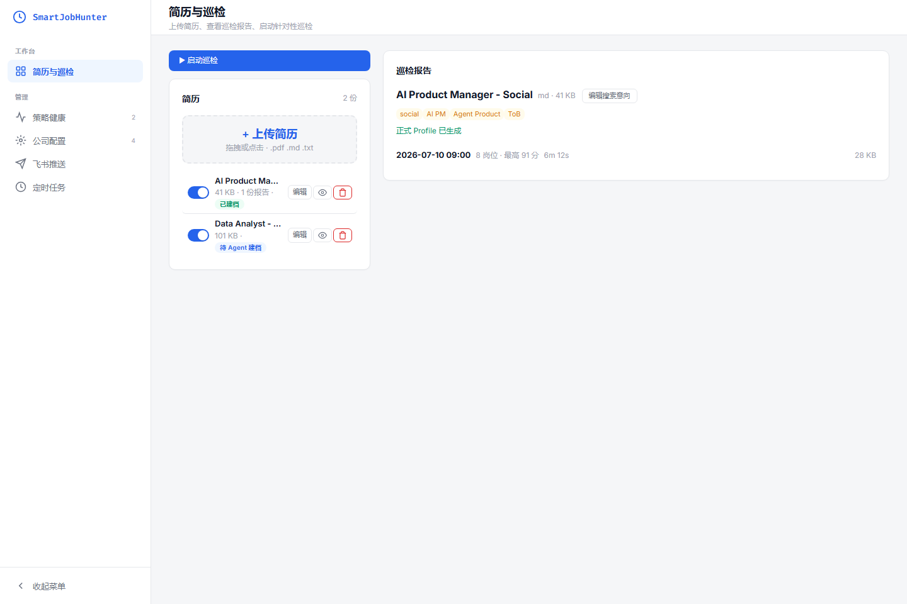
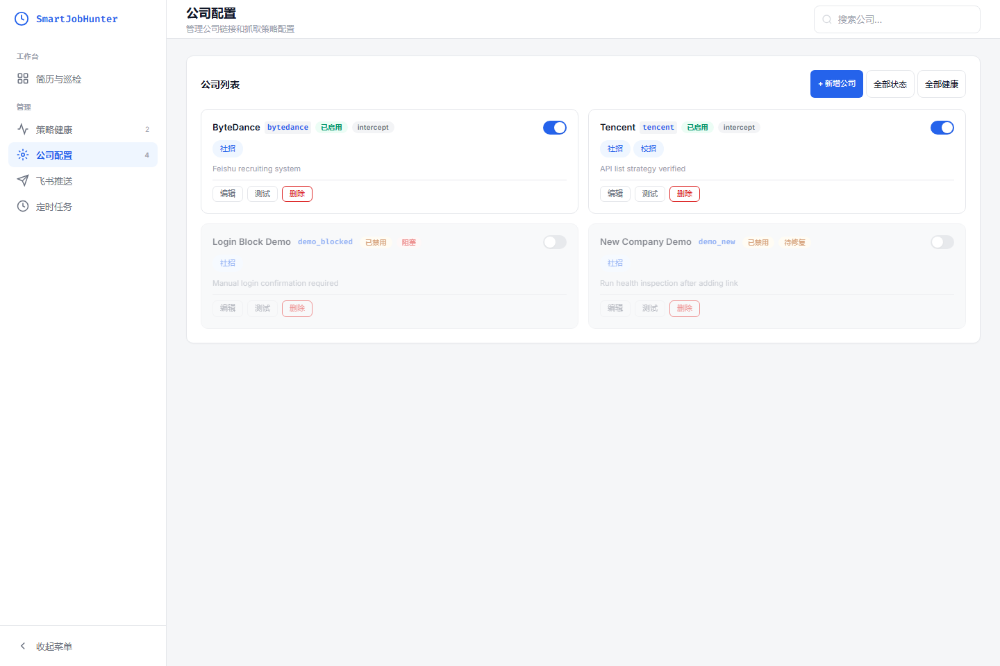

<div align="center">

# 🎯 SmartJobHunter

**🤖 LLM-Agent Driven Automated Job Hunting System**

[](LICENSE)
[](https://www.python.org/)
[]()

<p>
  <a href="README_CN.md"><b>🇨🇳 中文</b></a>
</p>

</div>

---

> Developer/operator manual in Chinese: [docs/usage-cn.md](docs/usage-cn.md).

## Why This Project

SmartJobHunter is an intelligent job-hunting tool for **company career-site monitoring**.
Most job tools focus on platforms like Boss, LinkedIn, or other job boards.
Those platforms are useful, but browsing them is not the hardest part, and their own recommendation systems are already mature.

The opportunities people miss are often the first-party roles that only appear on company career sites.
For large companies, the official career site is often the earliest publishing channel.
Some roles never flow into external job boards at all.

Checking 10 company sites by hand every day is still barely manageable.
Checking 100 company sites consistently is not.
This is where AI is useful: turning manual monitoring into automated coverage.

This project uses AI to automate that workflow, and upgrades the process from "finding jobs by keyword" to "judging whether a role fits you and helping you apply better." The goal is to reduce both missed opportunities and false positives.

## What This Solves

Job hunting is hard not only because you need to search for roles, but because you need to keep the whole filtering process reliable:

- **Official career sites are fragmented**: each company has a different page structure, search behavior, and field quality.
- **Surface relevance is not real fit**: a title or keyword match does not mean the role fits your target direction or experience.
- **Multiple job directions make screening harder**: when you track campus roles, internships, AI product, TOB product, and other directions at the same time, information volume and filtering complexity grow quickly.
- **Recommendations need evidence**: a useful shortlist should explain why a role matches, where the risks are, and what gaps remain.
- **Applications take more work after discovery**: resume tailoring, ATS fit, JD-based writing, and interview preparation often take more effort than finding the opening.

## What Makes It Different

### 1. Focuses on official career sites, not duplicated platform data

The goal is to cover **career-site-first, career-site-only, and not-yet-synced** openings, reducing the chance of missing first-party opportunities.

### 2. Finds roles, then filters for real fit

SmartJobHunter does not simply crawl everything and push a long list to the user.
It combines resume content, job intention, and preferences to reduce roles that look relevant but are not actually suitable.

### 3. Gives resume and application advice, not just job links

The system can analyze:

- where the JD and resume match
- what strong signals already exist in the candidate's experience
- what risks and gaps remain
- how the resume can be improved for the role

## Current Capabilities

- Monitor roles across multiple company career sites
- Filter duplicate and low-relevance openings
- Support different resumes and target roles, not only product-manager profiles
- Score job fit based on resume evidence, target profile, and JD evidence
- Output match reasons, supporting evidence, and risk warnings
- Generate structured job reports under date archives for faster application decisions
- Validate job detail URLs before reporting, keeping only reachable links
- Generate a Top 3 application package with JD-specific Cover Letters
- Run daily career-site strategy inspection and create evidence packages for Agent-side fixes
- Use a local Web console to upload/manage resumes, edit search intents, enable/disable companies, start inspections, and trigger strategy repair
- Optionally push finished daily results to Feishu Wiki and Bitable
- Run Agent evaluation in two layers: offline regression cases before changes, and real-run report scoring after human labels are added

## Planned Capabilities

- **Personal experience library and JD-based resume generation**
  Maintain a local wiki-style experience library, then generate an HTML resume version from a target JD plus selected personal experiences. This is planned to integrate with an existing open-source GitHub resume project instead of rebuilding the rendering layer from scratch.

- **JD-specific interview preparation**
  Generate an interview assistance document for each target role, including high-frequency questions, suggested answers, and evidence-backed talking points focused on that JD rather than generic interview questions.

- **Feishu conversation and daily reminders**
  Mount a Feishu chat/dialog entry so the system can send daily reminders after job crawling, including newly found roles, high-score recommendations, and roles that need manual review.

- **Post-interview review and strategy improvement**
  Support interview retrospectives from uploaded recordings or transcripts, compare actual questions against predicted questions, calculate hit rate, summarize gaps, and improve future JD-specific prediction strategy.

- **Richer application tracking**
  Extend the current report, Feishu, and Top 3 application package workflow into a fuller application tracker that records which resume, Cover Letter, and status were used for each role.

## One-Line Summary

**SmartJobHunter is not just a job crawler. It is an intelligent job-search agent that monitors company career sites, finds real fit, and helps improve resumes and application materials.**

## ✨ Features

| Feature | Description |
|:---:|:---|
| 🤖 **Agent-Driven** | The current Claude/Codex agent builds candidate profiles, job profiles, fit judgments, and explanations |
| 🎯 **General Profiles** | Supports product, data, engineering, and other target roles; product manager is only an example profile |
| 🎯 **Multi-Profile** | Support multiple job directions with independent resume inspection |
| 📄 **Resume Formats** | Supports PDF, Markdown, and TXT only; DOCX and images are currently unsupported |
| 🔍 **Smart Filtering** | Three-layer funnel: Time → Dedup → semantic intent match |
| 📊 **AI Evaluation** | Agent-owned final semantic scoring; Python fallback only provides candidate ranking and mechanical facts |
| 📊 **Job Classification** | Distinguish internship/campus/social recruitment |
| ⏰ **Scheduled Execution** | Configurable scheduled inspection through `src.scheduler` or external automation |
| 🔧 **Daily Strategy Inspection** | Inspect company links before crawling, collect evidence, and let the current Agent solidify crawler strategies |
| 🏢 **Company Sites** | Enabled company configs are validated by current test results |
| ⚙️ **Config-Driven** | Prefer config-driven company support; special sites may still need code adapters |
| 💻 **Local Web Console** | Upload/manage resumes, edit search intent, enable/disable companies, start inspections, and manage strategy repair |
| 📦 **Application Package** | Generate Top 3 JD-specific Cover Letters after link validation |
| 🗂️ **Date Archives** | Reports and application packages are stored by run date |
| 🧪 **Agent Evaluation** | Offline regression suite plus real-run report evaluation with focused human labels |

## Quickest Start

1. Put a PDF, Markdown, or TXT resume in `resumes/`, or upload it from the local Web console.
2. Enter search keywords and job types in the Web console. This creates only a `search_intent`, not a fake candidate profile.
3. Click Run Inspection. A visible CMD starts Claude Code with `--permission-mode auto`; the Agent reads the full resume and creates the formal profile.
4. Maintain company career links in `config/companies.yaml` and enable the companies you want to monitor.
5. Read results under `output/{date}/`; Top 3 application packages are under `output/{date}/application_packages/`.

If you prefer commands:

```powershell
python -m src.cli
python -m src.cli -t social
python -m src.cli -p "profile name"
```

## 🚀 Quick Start

### 1️⃣ Install Dependencies

```bash
pip install playwright pyyaml
playwright install chromium

# Optional: Parse PDF resumes
pip install PyMuPDF
```

### 2️⃣ Create Local Agent Config

Copy the sample config and keep your real secrets only in the local `config/agent.yaml`.
This file is ignored by Git and must not be committed.

```powershell
Copy-Item config\agent.sample.yaml config\agent.yaml
```

Then fill local-only settings such as Feishu app credentials, Wiki node token, and Bitable token in `config/agent.yaml`.
If a real secret was ever committed or pushed, rotate it in the Feishu developer console.

### 3️⃣ Add Resume and Search Intent

Do not hand-write `profiles/*.md` as the first step. A formal profile is generated by the Agent after reading the original resume.

Recommended flow:

1. Put a PDF, Markdown, or TXT resume in `resumes/`, or upload it from the local Web console.
2. Enter search keywords and job types in the Web console. This only saves a local `search_intent` in `config/resume_intents.yaml`.
3. Click Run Inspection. Claude Code reads the full resume plus `search_intent`, creates or refreshes `profiles/<profile_id>.md`, then starts crawling and matching.

Existing `profiles/*.md` files are Agent-generated profile outputs that you can inspect, review, enable, or disable. Do not turn a keyword list into a formal profile by hand.

### 4️⃣ Run Inspection

```bash
# Run all enabled profiles
python -m src.cli

# Specify job type
python -m src.cli -t social      # Social recruitment
python -m src.cli -t internship  # Internship
python -m src.cli -t campus      # Campus recruitment

# Specify profile
python -m src.cli -p "Product Manager"

# List all profiles
python -m src.cli --list-profiles
```

### 5️⃣ View Report

```bash
ls output/2026-05-07/
# pm_tob_20260507_2030.md
# application_packages/pm_tob_20260507_2030/
```

## 🖥️ Local Web Console

The local console is the easiest way to manage resumes, company links, inspections, and reports. It binds to `127.0.0.1` only:

```powershell
python -m uvicorn src.web_ui:app --host 127.0.0.1 --port 8080
```

Open [http://127.0.0.1:8080](http://127.0.0.1:8080). Main modules:

- **Resume & Inspection**: upload PDF/MD/TXT resumes, edit `search_intent`, start a visible Claude Code inspection, and view generated reports.
- **Company Config**: add or disable companies, edit social/campus/internship career links, and run a single-company crawl test.
- **Strategy Health**: inspect changed, unknown, failed, or blocked company links; create strategy tasks for the Agent to analyze.
- **Feishu Push / Schedule**: configure local Feishu push settings and scheduled inspection parameters.





## 📁 Directory Structure

```
SmartJobHunter/
├── 📂 src/                  # Python modules
│   ├── cli.py               # CLI entry point & JobHunter class
│   ├── crawler_factory.py   # Strategy-aware crawler factory
│   ├── config_crawler.py    # Config-driven crawler
│   ├── base_crawler.py      # Base crawler class (API intercept)
│   ├── company_registry.py  # Company link and strategy registry
│   ├── site_inspector.py    # Lightweight link/strategy inspection
│   ├── strategy_planner.py  # Strategy task planner
│   ├── crawler_evidence.py  # Page/network/DOM evidence collector
│   ├── health_monitor.py    # Daily strategy inspection and diagnosis
│   ├── notifier.py          # User notification system
│   ├── filters.py           # Filter functions (time, dedup, clean)
│   ├── matching.py          # Semantic matching fallback and scoring rubric
│   ├── evaluation.py        # Agent evaluation harness
│   ├── eval_real_runs.py    # Real report parser, human-label template, and real-run metrics
│   ├── eval_lark_sync.py    # Feishu/Lark annotation table and badcase doc sync
│   ├── eval_graders.py      # Explicit code/model/human grader helpers
│   ├── eval_transcript.py   # JSONL transcript recorder for eval cases
│   ├── resume_parser.py     # Resume parser (PDF/Markdown/TXT)
│   ├── scheduler.py         # Configurable scheduled inspection entry point
│   ├── site_strategies/     # Custom Python site strategies
│   └── git_auto_push.py     # Optional Git auto push
│
├── 📂 templates/            # Local Web console frontend
│   └── index.html
│
├── 📂 config/               # Configuration
│   ├── agent.sample.yaml    # Safe sample agent settings
│   ├── agent.yaml           # Local private agent settings (ignored by Git)
│   ├── companies.yaml       # Extensible company career-site config
│   └── system_templates.yaml # Recruiting system templates
│
├── 📂 profiles/             # Formal profiles generated by the Agent from resumes
├── 📂 resumes/              # Resume files
├── 📂 memory/               # Dedup data (seen_jobs.md)
├── 📂 output/               # Date-archived reports and application packages
├── 📂 logs/                 # Log files
├── 📂 tests/                # Test files
├── 📂 evals/                # Regression, capability, and candidate eval cases
│
├── 📂 .claude/skills/       # Claude Code Agent Skills
│   └── jobhunter/           # JobHunter Agent
│
├── 📄 setup_schedule.bat    # Windows Task Scheduler helper
├── 📄 run_scheduled.bat     # Windows scheduled-run wrapper
└── 📄 公司列表.md           # Company list documentation (Chinese)
```

## ⚙️ Configuration

### 📋 Agent-Generated Profile Format (profiles/*.md)

`profiles/*.md` files are generated from the original resume plus `config/resume_intents.yaml`; they are not the first-time manual setup step. The format below is for inspecting or maintaining generated profiles:

```markdown
---
name: Product Manager
enabled: true
job_type: 社招
resume: resumes/pm.md
keywords:
  - Product Manager
  - TOB
  - AI Product
---

# Job Intention

Looking for TOB SaaS Product Manager positions...
```

### 🤖 Agent Configuration

Use `config/agent.sample.yaml` as the tracked template and copy it to local `config/agent.yaml` before running the agent.
The local file can contain Feishu credentials and is intentionally ignored by Git.

```yaml
decision_level: "moderate"  # conservative / moderate / aggressive
time_filter_days: 3         # Only show jobs from last N days
threshold_score: 70         # Minimum score to include in report
jd_truncate_length: 6000    # Max job description length

agent_review:
  required_for_recommendation: true  # Formal recommendations require Agent review
  max_candidates: 40                 # Wider Agent review pool, separate from final report size
  results_path: ""                   # Optional Agent result JSON path

model_strategy:
  simple_tasks: "haiku"
  complex_tasks: "sonnet"

semantic_filter:
  conservative: 0.8
  moderate: 0.6
  aggressive: 0.4

output:
  max_jobs_per_report: 20  # Keep only the top N Agent-scored jobs in the final report

feishu:
  app_id: ""
  app_secret: ""
  wiki_node_token: ""
  bitable_token: ""
  bitable_table_id: ""
  eval_annotation_table_id: ""
  eval_badcase_doc_id: ""
  eval_badcase_doc_url: ""
  enabled: false
```

### 🏢 Company Configuration (config/companies.yaml)

`config/companies.yaml` is freely extensible. Start with the company's official career-site links; the crawler strategy can be filled in later by health inspection and Agent analysis.

Minimal entry:

```yaml
companies:
  - id: demo_company
    name: Demo Company
    enabled: true
    urls:
      social: "https://jobs.example.com/search?keyword={keyword}"
      campus: "https://jobs.example.com/campus?keyword={keyword}"
      internship: "https://jobs.example.com/intern?keyword={keyword}"
    note: "New company, strategy pending"
```

After adding or editing links, run health inspection so the system can collect page, DOM, network, screenshot, and error evidence:

```powershell
# Inspect one company
python -m src.health_monitor --inspect-company demo_company --keyword "AI Product Manager"

# Or inspect all enabled company strategies
python -m src.health_monitor --inspect-strategies --keyword "AI Product Manager" --job-type social
```

If a site is new, changed, blocked, or returns zero jobs, the health monitor writes a task under `logs/strategy_tasks/` and evidence under `logs/crawler_evidence/`. Give that task to the current Agent; the Agent analyzes the website behavior and solidifies a reusable strategy as `api` / `field_mappings` / `url_template` config or a dedicated Python strategy under `src/site_strategies/`.

Example of a fully recognized API strategy:

```yaml
companies:
  - id: tencent
    name: Tencent
    enabled: true
    urls:
      social: "https://careers.tencent.com/search.html?query={keyword}"
      campus: "https://careers.tencent.com/search.html?query={keyword}"
    api:
      pattern: "tencentcareer/api/post/Query"
      data_path: "Data.Posts"
      type: "intercept"
    field_mappings:
      id: {source: "PostId"}
      title: {source: "RecruitPostName"}
      location: {source: "LocationName"}
      category: {source: "CategoryName"}
      publish_time: {source: "LastUpdateTime"}
      duty: {source: "Responsibility"}
    url_template: "https://careers.tencent.com/position_detail.html?id={id}"
    job_type_detection:
      internship: ["实习", "intern"]
      campus: ["校招", "应届"]
```

## 🧠 Matching & Scoring Logic

SmartJobHunter no longer treats keyword hits as a match by themselves.

The matching flow is:

1. **Deterministic filters**: time window and deduplication stay in Python.
2. **Semantic intent filter**: the Agent judges whether the job's real responsibilities match the profile intent. Keywords are only supporting evidence.
3. **Agent review queue**: Python writes threshold-passing candidates to `output/<date>/agent_review_queues/`, up to `agent_review.max_candidates=40` by default; the Agent reads the full JD, profile, and fallback reference before scoring.
4. **Resume-job fit scoring**: the Agent scores role fit, core responsibilities, domain fit, resume evidence, seniority, risk, and application priority.
5. **Report ranking**: only Agent `strong_apply` and `apply` results above `threshold_score` enter the main recommendation section; `maybe` stays in the full audit as an observation candidate. Final display size is capped by `output.max_jobs_per_report`.
6. **URL validation**: report generation checks job detail links and drops empty or unreachable URLs.
7. **Application package**: the Top 3 scored jobs get a dedicated Cover Letter package.
8. **Python fallback**: `src.matching` supports candidate ranking, regression tests, and risk hints; by default it cannot create formal recommendations on its own.

Scoring dimensions:

| Dimension | Weight | Meaning |
|:--|:--:|:--|
| `core_role_fit` | 30 | Whether the job's core role matches the target role |
| `domain_fit` | 25 | Whether the domain matches the intent, such as AI Agent, LLM apps, ToB SaaS |
| `resume_evidence` | 25 | Whether the resume contains evidence for the JD requirements |
| `preference_fit` | 10 | Location, job type, and other stated preferences |
| `evidence_quality` | 10 | How clear and verifiable the JD/resume evidence is |
| `risk_penalty` | -20 | Keyword noise, role mismatch, or missing core evidence |

The Agent prompts live in `.claude/skills/jobhunter/prompts/` and require evidence-backed JSON output. For example, an "AI labeling operations" role should not be scored as a strong AI product match just because it contains "AI"; an uncertain `maybe` decision is not a formal recommendation.

## 💻 Command Reference

### CLI Commands

| Command | Description |
|:--------|:------------|
| `python -m src.cli` | Run all enabled profiles |
| `python -m src.cli -t social` | Run social recruitment only |
| `python -m src.cli -t internship` | Run internship only |
| `python -m src.cli -t campus` | Run campus recruitment only |
| `python -m src.cli -p "name"` | Run specific profile |
| `python -m src.cli --list-profiles` | List all profiles |

CLI outputs are date-archived:

```text
output/YYYY-MM-DD/<profile_id>_<YYYYMMDD_HHMM>.md
output/YYYY-MM-DD/application_packages/<profile_id>_<YYYYMMDD_HHMM>/
```

## ✅ Testing

```bash
# Unit and non-network tests
pytest -q -p no:cacheprovider -m "not integration"

# Matching/scoring tests only
pytest -q -p no:cacheprovider tests/test_matching.py

# Agent evaluation regression suite
python -m src.evaluation

# Stability check: run each case 3 times
python -m src.evaluation --trials 3 --fail-under 1.0

# Capability boundary suite
python -m src.evaluation --dataset evals/capability/jobhunter_hard_cases.yaml

# Real-run report evaluation: first creates human_labels.yaml, then rerun with labels
python -m src.eval_real_runs --report "output/YYYY-MM-DD/<report>.md"
python -m src.eval_real_runs --report "output/YYYY-MM-DD/<report>.md" --labels "output/evals/real_runs/YYYY-MM-DD/<run_id>/human_labels.yaml"

# Optional Feishu/Lark annotation workflow
lark-cli auth login --domain base
python -m src.eval_lark_sync setup
python -m src.eval_lark_sync export-labels --labels "output/evals/real_runs/YYYY-MM-DD/<run_id>/human_labels.yaml" --run-id "<run_id>"
python -m src.eval_lark_sync score-from-lark --report "output/YYYY-MM-DD/<report>.md" --run-id "<run_id>" --sync-badcases
```

Integration crawler tests require browser/network access and are marked with `integration`.

Agent evaluation reports are written under `output/evals/YYYY-MM-DD/` and are local artifacts.
Real-run evaluation reports are written under `output/evals/real_runs/YYYY-MM-DD/`.
Real-run reports now include Chinese metric names, optional 1-5 human dimension scores, and a `bad_cases.md` file. Feishu/Lark sync can create a dedicated annotation table in the existing job-tracking Bitable and a managed badcase document for review.
For the full internal Agent architecture, see `docs/smartjobhunter-agent-design.md`; for evaluation details, see `docs/smartjobhunter-evaluation-design.md`.

### Crawler Commands

| Command | Description |
|:--------|:------------|
| `python -m src.crawler_factory --list` | List all companies |
| `python -m src.crawler_factory --test <id>` | Test specific crawler |
| `python -m src.crawler_factory --crawl <id>` | Crawl specific company |

### Scheduler Commands

| Command | Description |
|:--------|:------------|
| `python -m src.scheduler --run` | Run inspection immediately |
| `python -m src.scheduler --check` | Run daily strategy inspection |
| `python -m src.scheduler --repair` | Print strategy tasks for the current Agent |
| `python -m src.scheduler --schedule` | Scheduled mode (called by system) |
| `python -m src.scheduler --feishu-push status` | Show Feishu Wiki/Bitable push switch |
| `python -m src.scheduler --feishu-push on` | Enable Feishu push after reports |
| `python -m src.scheduler --feishu-push off` | Disable Feishu push after reports |

### Health Monitor Commands

| Command | Description |
|:--------|:------------|
| `python -m src.health_monitor --inspect-strategies` | Inspect all enabled company links and strategies |
| `python -m src.health_monitor --inspect-company <id>` | Inspect one company link and strategy |
| `python -m src.health_monitor --check <id>` | Legacy single crawler check |
| `python -m src.health_monitor --check-all` | Legacy all-crawler check |
| `python -m src.health_monitor --report` | Generate health report |

The Web console usage and screenshots are in the Local Web Console section above.

## 🏢 Company Coverage and Extension

Company coverage is configuration-driven, not a fixed tier list. The current repository includes example and working career-site configs, but you can freely add, disable, or update companies in `config/companies.yaml` or through the Web console.

Use the Web console when you want a visual workflow:

1. Open **Company Config**.
2. Click **Add Company**.
3. Fill company ID, display name, and social/campus/internship career links.
4. Save and run **Test** or open **Strategy Health** for batch inspection.

Use commands when you want a reproducible workflow:

```powershell
python -m src.health_monitor --inspect-company <company_id> --keyword "AI Product Manager"
python -m src.health_monitor --inspect-strategies --keyword "AI Product Manager" --job-type social
```

When inspection finds an unknown API, changed DOM, login gate, anti-crawl block, or zero-job result, SmartJobHunter writes an Agent-readable task and evidence package. The Agent then decides whether the reusable fix belongs in `config/companies.yaml`, `config/system_templates.yaml`, or `src/site_strategies/`.

### 🔧 Adding New Companies

Company support starts from `config/companies.yaml`, but not every official career site can be handled by configuration alone. The intended workflow is:

1. Add or update the company's official career links in `config/companies.yaml`.
2. Run daily strategy inspection or a company-specific inspection.
3. Let the current Claude/Codex Agent review the collected evidence when the site is new, changed, blocked, or failing.
4. Solidify the reusable solution either as config (`api`, `field_mappings`, `url_template`) or as a dedicated Python strategy under `src/site_strategies/`.
5. Rerun the crawler test before considering the company supported.

For standard API/list pages, config may be enough:

Example:

```yaml
- id: new_company
  name: New Company
  enabled: true
  urls:
    social: "https://jobs.example.com/search?keyword={keyword}"
  api:
    pattern: "api/job/list"
    data_path: "data.jobs"
    type: "intercept"
  field_mappings:
    id: {source: "jobId"}
    title: {source: "title"}
    location: {source: "city"}
    category: {source: "category"}
    publish_time: {source: "publishDate"}
    duty: {source: "description"}
  url_template: "https://jobs.example.com/detail/{id}"
  job_type_detection:
    internship: ["实习", "intern"]
    campus: ["校招", "应届"]
```

For login-heavy, anti-crawl, browser-only, or unusual sites, keep the company enabled only after a strategy has been validated. Strategy evidence is written under `logs/strategy_tasks/` so the Agent can explain what changed and what still needs manual review.

## 🔧 Daily Strategy Inspection

SmartJobHunter does not pretend that Python can autonomously understand every recruiting site. Python collects evidence and runs known strategies; the current Claude/Codex Agent analyzes failures and turns a working approach into reusable config or code.

### Architecture

```
Daily Task → Load Profiles + Company Links
          → Strategy Inspection
          → Evidence Collection (page, DOM, network, screenshot, errors)
          → Crawl Known Companies
          → Agent Strategy Tasks for new/changed/failed companies
          → User Report + Optional Feishu Push
```

### Components

| Module | Purpose |
|:-------|:--------|
| `company_registry.py` | Read and normalize configured company links |
| `site_inspector.py` | Inspect official pages, detect redirects, login gates, blocked pages, and evidence |
| `crawler_evidence.py` | Capture page, DOM, network, screenshot, and error evidence |
| `strategy_planner.py` | Turn inspection results into Agent-readable strategy tasks |
| `health_monitor.py` | Coordinate daily strategy inspection and legacy health checks |
| `crawler_factory.py` | Choose config crawlers or dedicated Python strategies |

### Strategy Outcomes

| Outcome | What Happens |
|:--------|:-------------|
| Known and healthy | Continue normal crawl |
| New link or unknown strategy | Collect evidence and create an Agent strategy task |
| Link invalid or redirected | Capture final URL/status and ask Agent to update config |
| No jobs returned | Keep crawling other companies, collect evidence, and report the suspected cause |
| Login required | Mark as blocked/manual unless a permitted browser workflow exists |
| Anti-crawl or blocked | Record evidence and avoid claiming success |
| Config/code bug | Report the failing strategy and rerun tests after repair |

### Recruiting System Templates

`config/system_templates.yaml` remains useful as a legacy template library and strategy hint source:

| System | API Pattern | Data Path | Companies |
|:-------|:------------|:----------|:----------|
| Mokahr | `jobs` | `data.jobs` | Zhihu, ZTE, Geely, Tesla |
| Feishu | `search/job/posts` | `data.job_post_list` | ByteDance, Lilith, SenseTime, NIO |
| Workday | DOM parsing | - | Intel, AMD, Cisco, SAP, Lenovo |
| Beisen | DOM parsing | - | Inspur |
| Phenom | API intercept | - | Microsoft |
| Self-built | Varies | Varies | Tencent, Alibaba, Meituan, etc. |

## 🔄 Workflow

### Inspection Flow

```
1. Load Config        → Read enabled profiles, resumes, company links, and Agent settings
2. Inspect Strategies → Check new/changed/failed company links and collect evidence
3. Crawl Jobs         → Use config crawlers or dedicated Python strategies
4. Filter             → Time → Dedup → Semantic intent
5. Evaluate           → Agent reads the review queue and writes scores (0-100), evidence-backed reasons, and risks
6. Validate URLs      → Drop empty or unreachable job detail links before reporting
7. Generate Outputs   → Date-archived Markdown report + Top 3 application package
8. Push/Notify        → Optional Feishu Wiki/Bitable push and optional Git auto-push
9. Update Memory      → Append accepted job hashes to seen_jobs.md
```

### Filter Pipeline

```
Raw Jobs (from crawlers)
    ↓
[Time Filter] Keep jobs from last N days (default: 3)
    ↓
[Dedup Filter] Remove seen jobs (hash-based)
    ↓
[Data Clean] Truncate, normalize text
    ↓
[Semantic Intent Filter] Judge real role fit; keywords are supporting evidence only
    ↓
[Agent Review Scoring] Read queue, score, sort, threshold, cap report size
    ↓
[URL Validation] Remove unavailable or empty job links
    ↓
[Application Package] Generate Cover Letters for the Top 3 scored jobs
```

## 🤖 Agent Architecture

SmartJobHunter uses an LLM-Agent architecture:

```
User Request → Agent (Claude) → Tools (Python) → Output
                    ↓
              ┌─────────┐
              │  State  │
              │ Machine │
              └─────────┘
                    ↓
    INIT → LOADED → CRAWLED → FILTERED → EVALUATED
         → URL_VALIDATED → REPORTED → PACKAGED → DONE
```

### Agent Skills

Located in `.claude/skills/jobhunter/`:

- `skill.md` - Main agent entry point
- `tools/*.md` - Tool definitions (crawl, filter, load_config)
- `prompts/evaluate.md` - Evidence-backed fit scoring
- `prompts/report.md` - Report, URL-validation, and application package guidance
- `prompts/analyze_crawler_strategy.md` - Strategy repair guidance for new/changed/failed career sites

## 📄 Output Example

Reports are written under the current run date. The same run can also create an application package for the Top 3 scored jobs.

The recommendation section only shows final selected jobs. The same report keeps a full audit appendix with every crawled job, complete JD fields, original URL, processing stage, judgment source, evidence, scoring breakdown, and final decision. By default, formal recommendations must have `judgment_source=agent` and final decision `strong_apply` or `apply`; `maybe` remains an observation candidate, and `python_fallback` can only feed the review queue.

```markdown
# Job Hunting Report

## Basic Info
- **Profile**: Product Manager
- **Job Type**: 社招
- **Generated**: 2026-05-07 20:00
- **Jobs Found**: 15
- **Output Path**: output/2026-05-07/pm_tob_20260507_2000.md

## Intent
Looking for TOB SaaS Product Manager positions...

---

## Recommended Jobs

### 1. AI Product Manager 🟢 85 points

| Field | Value |
|:------|:------|
| Company | Tencent |
| Location | Beijing |
| Category | Product |
| Published | 2026-04-17 |

**Match Reasons**: Product Manager, AI Product, TOB

**Duties**:
负责AI产品的规划和设计...

**Link**: [View Job](https://careers.tencent.com/position_detail.html?id=xxx)

---
```

Application package example:

```text
output/2026-05-07/application_packages/pm_tob_20260507_2000/
├── index.md
├── cover_letter_1_tencent_ai_product_manager.md
├── cover_letter_2_bytedance_ai_product_manager.md
└── cover_letter_3_meituan_marketing_ai_product_manager.md
```

## 🧪 For Developers: Evaluation and Bad Cases

SmartJobHunter has two evaluation layers:

| Layer | Data | Purpose | Command |
|:--|:--|:--|:--|
| Regression eval | Fixed YAML cases | Catch crawler/filter/scoring/report/instruction regressions before merging | `python -m src.evaluation --fail-under 1.0` |
| Real-run eval | Generated reports + human labels | Measure recommendation quality on real crawls | `python -m src.eval_real_runs --report "output/YYYY-MM-DD/<report>.md"` |

Recommended workflow:

1. Run a real inspection and keep the generated report under `output/YYYY-MM-DD/`.
2. Create the real-run eval bundle:

```powershell
python -m src.eval_real_runs --report "output/YYYY-MM-DD/<report>.md"
```

3. Optional: sync labels to Feishu/Lark so a human can label online:

```powershell
lark-cli auth login --domain base
python -m src.eval_lark_sync setup
python -m src.eval_lark_sync export-labels --labels "output/evals/real_runs/YYYY-MM-DD/<run_id>/human_labels.yaml" --run-id "<run_id>"
```

4. After labeling in Feishu/Lark, pull labels back, recompute metrics, and sync the badcase document:

```powershell
python -m src.eval_lark_sync score-from-lark --report "output/YYYY-MM-DD/<report>.md" --run-id "<run_id>" --sync-badcases
```

Human labels:

| Label | Meaning | Metric role |
|:--|:--|:--|
| `should_apply` | clearly worth applying | positive |
| `maybe` | worth observing, but not a main recommendation requirement | weak positive / observation |
| `should_reject` | should not be recommended | false positive when system recommended |
| `invalid_link` | link is unusable in practice | URL quality issue |
| `unclear` | evidence is insufficient | excluded from precision/recall, counted separately |

Core metrics:

| Metric | Meaning |
|:--|:--|
| `recommendation_precision` | recommended jobs labeled `should_apply` or `maybe` / labeled recommended jobs |
| `strict_recommendation_precision` | system `strong_apply` jobs labeled `should_apply` / labeled `strong_apply` jobs |
| `reviewed_recall` | labeled positive or weak-positive samples covered by recommendation or `agent_maybe` / non-capacity-truncated positives |
| `reviewed_false_negative_rate` | labeled positive or weak-positive samples missed by recommendation and `agent_maybe` / non-capacity-truncated positives |
| `candidate_limit_omission_rate` | positive samples omitted only by Agent review pool or final report size limits / labeled positives |
| `agent_reviewed_recommendation_rate` | recommendations with `judgment_source=agent` / recommendations |
| `invalid_url_rate` / `recommended_invalid_url_rate` | invalid URLs in all records / recommended records |
| `maybe_rate` / `unclear_rate` | human `maybe` or `unclear` labels / completed labels |

Bad cases are written to `bad_cases.md` and can be mirrored to Feishu/Lark. Use them as the repair queue:

- `recommendation_false_positive`: recommended but human says `should_reject`; fix scoring, risk penalties, or Agent prompt rules.
- `filtered_false_negative`: not recommended but human says `should_apply` or `maybe`; fix semantic filtering, thresholds, or role matching.
- `candidate_limit_omitted`: good job omitted only by pool/report size; adjust `agent_review.max_candidates` or report limits, not semantic rules.
- `recommended_invalid_url` / `manual_invalid_link`: fix URL validation or source URL preservation.
- `agent_review_missing`: formal recommendation did not come from Agent scoring; fix the review flow.
- `evidence_unclear`: add JD/resume evidence or lower the recommendation level.

Detailed design: [docs/smartjobhunter-evaluation-design.md](docs/smartjobhunter-evaluation-design.md).

## 📜 License

**MIT License** © 2026 SmartJobHunter

**⭐ If this project helps you, please give it a star! ⭐**

Made with ❤️ by SmartJobHunter Team
