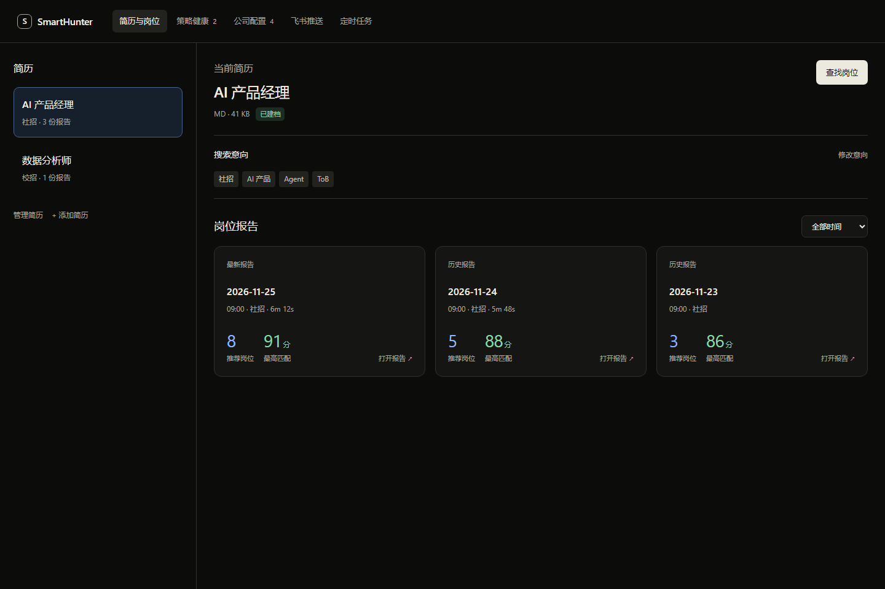
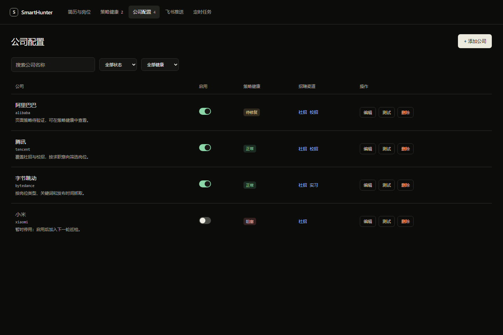

<div align="center">

# 🎯 SmartJobHunter

**🤖 基于 LLM-Agent 的自动化求职巡检系统**

[](LICENSE)
[](https://www.python.org/)
[]()

<p>
  <a href="README.md"><b>🇺🇸 English</b></a>
</p>

</div>

---

> 开发者/维护者操作手册：需要完整命令、策略修复、评估回归时看 [docs/usage-cn.md](docs/usage-cn.md)。

## 为什么做这个项目

这是一个面向 **公司官网岗位巡检** 的智能求职工具。
大多数求职工具都在抓 Boss、LinkedIn 这类招聘平台。
但说实话，刷这些平台本身并不算最麻烦的事，而且它们自己的推荐机制已经很成熟了。

真正容易错过的，是那些没有同步到招聘平台、只发布在公司官网的一手岗位。
尤其是大公司，官网往往是岗位最早的发布入口，有些岗位甚至根本不会流入外部平台。

手动每天刷 10 家公司的官网还勉强能坚持。
但如果是 100 家，几乎不可能长期稳定做到。
这正是 AI 更适合发挥价值的地方：把人工巡检变成自动化覆盖。

这个项目希望用 AI 把这件事自动化，同时把通过“关键词”找岗位，进一步升级为“判断岗位是否适合你、并帮助你更好地投递”，尽可能减少漏刷和误判。

## 这个项目解决什么问题

求职真正麻烦的地方，不只是搜岗位，而是：

- **官网信息分散**：不同公司的招聘页结构、搜索方式和字段质量差异很大，人工巡检成本高。
- **表面相关不等于适合**：岗位标题或关键词命中，不代表真的和求职方向、经历匹配。
- **多个求职方向并行时更难筛**：当你同时看校招、实习、AI 产品、TOB 产品等不同方向时，信息量和筛选复杂度会明显上升，人工维护会越来越混乱。
- **筛选需要依据**：有价值的推荐不能只给一个岗位链接，还要说明为什么匹配、风险在哪里、缺口是什么。
- **后续申请也很耗时**：简历如何改、如何贴 ATS、怎么基于 JD 准备求职文稿，往往比找岗位更花精力。

## 这个项目有什么不同

### 1. 重点盯官网，而不是重复平台信息

目标是覆盖 **官网首发、官网独有、平台未同步** 的岗位，减少错过一手机会的可能。

### 2. 不只发现岗位，还做精准匹配和过滤

不是简单抓取后全部推给用户，而是结合简历、求职意向和偏好，对岗位进行筛选，减少“看起来相关、其实不适合”的噪音。

### 3. 不只推荐岗位，还给出简历和申请建议

系统不仅判断“值不值得投”，还会进一步分析：

- JD 和简历的匹配点在哪里
- 当前经历的强信号是什么
- 风险和缺口是什么
- 简历还可以往哪里优化

## 当前能力

- 自动巡检多家公司官网职位
- 过滤重复岗位和低相关岗位
- 支持不同岗位方向的简历与求职目标配置，不限定产品经理
- 基于简历证据、求职目标和 JD 证据进行岗位匹配评分
- 输出推荐理由、匹配证据和风险提示
- 按日期归档生成结构化岗位报告，帮助快速判断是否值得投递
- 生成报告前校验岗位详情链接，只保留真实可访问链接
- 为 Top 3 高匹配岗位生成一键投递包和定制 Cover Letter
- 每日任务会主动巡检公司官网链接和抓取策略，为 Agent 修复提供证据
- 提供本地 Web 控制台，用于上传/管理简历、维护搜索意向、启用/禁用公司、启动巡检和触发策略修复
- 可选把每日跑完结果推送到飞书 Wiki 和多维表格
- 提供两层 Agent 评估：跑前离线回归，跑后基于真实报告和人工标签计算实测指标

## 规划中的能力

- **个人经历库与 JD 定制简历生成**
  支持通过本地 Wiki 维护个人经历库；用户可通过命令选择目标 JD 和相关经历，自动生成 HTML 版本简历。简历渲染层计划集成已有开源 GitHub 项目，不从零重复造轮子。

- **面向 JD 的面试辅助文档**
  针对每个目标岗位生成面试辅助文档，包括高频问题、参考答案、可引用的项目证据和表达要点；重点围绕当前 JD，而不是生成泛化面试题。

- **飞书对话框与每日提醒**
  挂载飞书对话入口，每天抓取岗位后自动发送飞书提醒，包含新增岗位、高分推荐岗位以及需要人工复核的风险岗位。

- **面试后复盘与预测策略优化**
  支持上传面试录音或文稿，自动生成复盘和改进建议；将真实面试问题与预测问题做命中率比对，分析遗漏点，并反向优化后续 JD 面试问题预测策略。

- **更完整的投递跟踪**
  把当前报告、飞书推送和 Top 3 投递包进一步扩展成投递跟踪体系，记录每个岗位使用的简历、Cover Letter 和投递状态。

## 一句话概括

**这不是一个单纯的岗位抓取器，而是一个从官网巡检、精准匹配，到简历优化和求职文稿生成的智能求职代理。**

## ✨ 功能特性

| 功能 | 描述 |
|:---:|:---|
| 🤖 **Agent 驱动** | 当前 Claude/Codex agent 负责简历画像、岗位画像、匹配判断与解释 |
| 🎯 **通用求职目标** | 支持产品、数据、研发等不同岗位方向；产品经理只是示例 profile |
| 🎯 **多意向并行** | 支持多个求职方向，每份简历独立巡检 |
| 📄 **简历格式** | 仅支持 PDF、Markdown、TXT；DOCX 和图片暂不支持 |
| 🔍 **智能过滤** | 三层漏斗：时间 → 去重 → 语义意向匹配 |
| 📊 **AI 评估** | Agent 主导最终语义评分；Python fallback 只负责候选排序和机械事实 |
| 📊 **岗位分类** | 区分实习/校招/社招 |
| ⏰ **定时执行** | 通过 `src.scheduler` 或外部自动化配置定时巡检 |
| 🔧 **每日策略巡检** | 抓取前巡检公司链接，采集证据，并由当前 Agent 固化可复用抓取策略 |
| 🏢 **公司官网** | 配置中启用的公司以当前测试结果为准 |
| ⚙️ **配置驱动** | 优先通过配置添加公司，特殊站点可能需要代码适配 |
| 💻 **本地 Web 控制台** | 上传/管理简历、编辑搜索意向、启用/禁用公司、启动巡检、管理策略修复 |
| 📦 **一键投递包** | 链接校验后为 Top 3 岗位生成定制 Cover Letter |
| 🗂️ **日期归档** | 报告和投递包按运行日期保存 |
| 🧪 **Agent 评估** | 离线回归评测 + 真实巡检报告人工标注评估 |

## 最简单使用方式

1. 把 PDF、Markdown 或 TXT 简历放到 `resumes/`，也可以通过 Web 控制台上传。
2. 在 Web 中填写搜索关键词和岗位类型；这里只保存 `search_intent`，不会伪造正式 profile。
3. 点击“启动巡检”，可见 CMD 会用 `--permission-mode auto` 启动 Claude Code；Agent 读取完整简历后生成正式 profile。
4. 在 `config/companies.yaml` 里维护招聘链接并启用目标公司。
5. 结果看 `output/{日期}/`；Top 3 投递包看 `output/{日期}/application_packages/`。

会用命令的话，也可以直接跑：

```powershell
python -m src.cli
python -m src.cli -t social
python -m src.cli -p "意向名称"
```

## 🚀 快速开始

### 1️⃣ 安装依赖

```bash
pip install playwright pyyaml
playwright install chromium

# 可选：解析 PDF 简历
pip install PyMuPDF
```

### 2️⃣ 创建本地 Agent 配置

先复制示例配置，把真实密钥只保存在本地 `config/agent.yaml`。
该文件已被 Git 忽略，不应提交到 GitHub。

```powershell
Copy-Item config\agent.sample.yaml config\agent.yaml
```

然后在本地 `config/agent.yaml` 中填写飞书应用凭证、Wiki 节点 token、多维表格 token 等私有配置。
如果真实密钥曾经被提交或推送过，需要在飞书开发者后台轮换或重置。

### 3️⃣ 添加简历和搜索意向

不要手写 `profiles/*.md` 作为第一步。正式 profile 是 Agent 读取简历原件后生成的画像文件。

推荐方式：

1. 把 PDF、Markdown 或 TXT 简历放到 `resumes/`，或在本地 Web 控制台上传。
2. 在 Web 控制台填写搜索关键词和岗位类型；这些内容只会保存到本地 `config/resume_intents.yaml`。
3. 点击“启动巡检”后，Claude Code 会读取完整简历和 `search_intent`，生成或刷新 `profiles/<profile_id>.md`，再开始抓取和匹配。

已有的 `profiles/*.md` 可以作为 Agent 生成后的画像结果查看、复核、启用或禁用；不建议把关键词列表手动包装成正式 profile。

### 4️⃣ 运行巡检

```bash
# 运行所有启用的意向
python -m src.cli

# 指定岗位类型
python -m src.cli -t social      # 社招
python -m src.cli -t internship  # 实习
python -m src.cli -t campus      # 校招

# 指定意向
python -m src.cli -p "产品经理"

# 列出所有意向
python -m src.cli --list-profiles
```

### 5️⃣ 查看报告

```bash
ls output/2026-05-07/
# pm_tob_20260507_2030.md
# application_packages/pm_tob_20260507_2030/
```

## 🖥️ 本地 Web 控制台

本地控制台是管理简历、公司链接、巡检和报告的最简单入口。它只绑定 `127.0.0.1`：

```powershell
python -m uvicorn src.web_ui:app --host 127.0.0.1 --port 8080
```

打开 [http://127.0.0.1:8080](http://127.0.0.1:8080)。主要模块：

- **简历与岗位**：选择 PDF/MD/TXT 简历，管理它的搜索意向和岗位报告；点击“查找岗位”启动任务，在居中大弹框中阅读 Markdown 报告。
- **公司配置**：新增或禁用公司，编辑社招/校招/实习官网链接，单公司测试抓取。
- **策略健康**：检查变化、未知、失败或阻断的公司链接，生成给 Agent 分析的网站策略任务。
- **飞书推送**：配置本地飞书推送设置。
- **定时任务**：配置自动查找岗位和推送选项。

五个模块均可从导航直接进入。深色控制台围绕所选简历组织搜索意向和报告，支持窄屏布局，并用颜色区分结果指标。下方截图使用演示数据。





运行 `python -X utf8 tests/check_web_console.py` 可复查隔离的浏览器交互；添加 `--screenshots` 可用演示数据重新生成这两张截图。

## 📁 目录结构

```
SmartJobHunter/
├── 📂 src/                  # Python 模块
│   ├── cli.py               # CLI 入口 & JobHunter 类
│   ├── crawler_factory.py   # 爬虫工厂（配置爬虫 + 专用策略）
│   ├── config_crawler.py    # 配置驱动爬虫
│   ├── base_crawler.py      # 爬虫基类（API 拦截）
│   ├── company_registry.py  # 公司链接注册表
│   ├── site_inspector.py    # 官网链接与策略巡检
│   ├── strategy_planner.py  # Agent 策略任务生成
│   ├── crawler_evidence.py  # 页面/网络/DOM 证据采集
│   ├── health_monitor.py    # 每日策略巡检与诊断
│   ├── notifier.py          # 用户通知系统
│   ├── filters.py           # 过滤函数（时间、去重、清洗）
│   ├── matching.py          # 语义匹配 fallback 与评分规则
│   ├── evaluation.py        # Agent 评估 harness
│   ├── eval_real_runs.py    # 真实报告解析、人工标注模板和实测指标
│   ├── eval_lark_sync.py    # 飞书标注表、badcase 文档和评估报告同步
│   ├── eval_graders.py      # 显式 code/model/human grader helper
│   ├── eval_transcript.py   # eval case 的 JSONL 轨迹记录器
│   ├── resume_parser.py     # 简历解析（PDF/Markdown/TXT）
│   ├── scheduler.py         # 可配置定时巡检入口
│   ├── git_auto_push.py     # 可选 Git 自动推送
│   └── site_strategies/     # 专用公司抓取策略
│
├── 📂 templates/            # 本地 Web 控制台前端
│   └── index.html
│
├── 📂 config/               # 配置文件
│   ├── agent.sample.yaml    # 可提交的 Agent 示例配置
│   ├── agent.yaml           # 本地私有 Agent 配置（Git 忽略）
│   ├── companies.yaml       # 可自由扩展的公司官网链接配置
│   └── system_templates.yaml # 招聘系统模板
│
├── 📂 profiles/             # Agent 读取简历后生成的正式求职画像
├── 📂 resumes/              # 简历文件
├── 📂 memory/               # 去重数据（seen_jobs.md）
├── 📂 output/               # 按日期归档的报告和投递包
├── 📂 logs/                 # 日志文件
├── 📂 tests/                # 测试文件
├── 📂 evals/                # regression、capability 和候选 eval cases
│
├── 📂 .claude/skills/       # Claude Code Agent Skills
│   └── jobhunter/           # JobHunter Agent
│
├── 📄 setup_schedule.bat    # Windows 任务计划创建脚本
├── 📄 run_scheduled.bat     # Windows 定时巡检启动脚本
└── 📄 公司列表.md           # 公司列表文档
```

## ⚙️ 配置说明

### 📋 Agent 生成的 Profile 格式 (profiles/*.md)

`profiles/*.md` 是 Agent 读取简历原件和 `config/resume_intents.yaml` 后生成的正式画像，不是新用户需要手写的起始配置。下面格式用于检查和维护生成结果：

```markdown
---
name: 产品经理
enabled: true
job_type: 社招
resume: resumes/pm.md
keywords:
  - 产品经理
  - TOB
  - AI产品
---

# 求职意向

寻找 TOB SaaS 产品经理岗位...
```

### 🤖 Agent 配置

`config/agent.sample.yaml` 是可提交的模板；运行前复制为本地 `config/agent.yaml`。
本地文件可包含飞书密钥，已被 Git 忽略。

```yaml
decision_level: "moderate"  # conservative / moderate / aggressive
time_filter_days: 3         # 只显示最近 N 天的岗位
threshold_score: 70         # 最低评分阈值
jd_truncate_length: 6000    # JD 最大长度

agent_review:
  required_for_recommendation: true  # 正式推荐默认要求 Agent 复核
  max_candidates: 40                 # Agent 复核池上限，独立于最终报告数量
  results_path: ""                   # 可选：指定 Agent 结果 JSON 路径

model_strategy:
  simple_tasks: "haiku"
  complex_tasks: "sonnet"

semantic_filter:
  conservative: 0.8
  moderate: 0.6
  aggressive: 0.4

output:
  max_jobs_per_report: 20  # 最终报告只保留 Agent 评分最高的 N 个岗位

feishu:
  app_id: ""
  app_secret: ""
  wiki_node_token: ""
  bitable_token: ""
  bitable_table_id: ""
  eval_annotation_table_id: ""
  eval_badcase_doc_id: ""
  eval_badcase_doc_url: ""
  eval_report_doc_id: ""
  eval_report_doc_url: ""
  enabled: false
```

### 🏢 公司配置 (config/companies.yaml)

`config/companies.yaml` 可以自由扩展。新增公司时先写官网招聘链接；抓取策略可以通过健康检测和 Agent 分析后再补齐。

最小配置：

```yaml
companies:
  - id: demo_company
    name: 示例公司
    enabled: true
    urls:
      social: "https://jobs.example.com/search?keyword={keyword}"
      campus: "https://jobs.example.com/campus?keyword={keyword}"
      internship: "https://jobs.example.com/intern?keyword={keyword}"
    note: "新公司，策略待识别"
```

新增或修改链接后，先启动健康检测，让系统采集页面、DOM、网络请求、截图和错误证据：

```powershell
# 巡检单家公司
python -m src.health_monitor --inspect-company demo_company --keyword "AI产品经理"

# 或巡检所有已启用公司策略
python -m src.health_monitor --inspect-strategies --keyword "AI产品经理" --job-type social
```

如果网站是新链接、页面变化、被阻断或返回 0 岗位，健康检测会把任务写到 `logs/strategy_tasks/`，证据写到 `logs/crawler_evidence/`。把这个任务交给当前 Agent 后，Agent 会分析网站行为，并把可复用策略固化成 `api` / `field_mappings` / `url_template` 配置，或固化成 `src/site_strategies/` 下的专用 Python 策略。

完整 API 策略示例：

```yaml
companies:
  - id: tencent
    name: 腾讯
    enabled: true
    urls:
      social: "https://careers.tencent.com/search.html?query={keyword}"
      campus: "https://careers.tencent.com/search.html?query={keyword}"
    api:
      pattern: "tencentcareer/api/post/Query"
      data_path: "Data.Posts"
      type: "intercept"
    field_mappings:
      id: {source: "PostId"}
      title: {source: "RecruitPostName"}
      location: {source: "LocationName"}
      category: {source: "CategoryName"}
      publish_time: {source: "LastUpdateTime"}
      duty: {source: "Responsibility"}
    url_template: "https://careers.tencent.com/position_detail.html?id={id}"
    job_type_detection:
      internship: ["实习", "intern"]
      campus: ["校招", "应届"]
```

## 🧠 匹配与评分逻辑

SmartJobHunter 不再把关键词命中本身视为匹配。

匹配流程：

1. **确定性过滤**：时间窗口和去重仍由 Python 处理。
2. **语义意向过滤**：Agent 判断岗位真实职责是否符合求职意向，关键词只作为辅助证据。
3. **Agent 复核队列**：Python 将达到阈值的候选岗位写入 `output/<date>/agent_review_queues/`，默认最多 `agent_review.max_candidates=40` 个；Agent 读取完整 JD、profile 和 fallback 参考后打分。
4. **简历-岗位匹配评分**：Agent 按角色匹配、核心职责、领域匹配、简历证据、职级、风险和投递优先级评分。
5. **报告排序**：只有 Agent 最终结论为 `strong_apply` 或 `apply` 且达到 `threshold_score` 的岗位进入主推荐区；`maybe` 只保留在全量审计里作为备选观察，最终展示数量才受 `output.max_jobs_per_report` 控制。
6. **链接校验**：生成报告前检查岗位详情链接，过滤空链接或不可访问链接。
7. **投递包生成**：为 Top 3 高分岗位生成独立 Cover Letter 包。
8. **Python fallback**：`src.matching` 用于候选排序、回归测试和风险提示；默认不能单独生成正式推荐。

评分维度：

| 维度 | 权重 | 含义 |
|:--|:--:|:--|
| `core_role_fit` | 30 | 岗位核心角色是否符合目标方向 |
| `domain_fit` | 25 | 是否符合 AI Agent、大模型应用、ToB SaaS 等目标领域 |
| `resume_evidence` | 25 | 简历是否有能支撑 JD 要求的证据 |
| `preference_fit` | 10 | 地点、岗位性质和其他偏好是否一致 |
| `evidence_quality` | 10 | JD 和简历证据是否清晰、可验证 |
| `risk_penalty` | -20 | 关键词噪声、角色偏离或核心证据缺失 |

Agent 提示词位于 `.claude/skills/jobhunter/prompts/`，要求输出有证据支撑的 JSON。例如，“AI 标注运营”不能只因为包含 “AI” 就被评为强匹配 AI 产品岗位；不确定的 `maybe` 不是正式推荐。

## 💻 命令参考

### CLI 命令

| 命令 | 说明 |
|:-----|:-----|
| `python -m src.cli` | 运行所有启用的意向 |
| `python -m src.cli -t social` | 只运行社招 |
| `python -m src.cli -t internship` | 只运行实习 |
| `python -m src.cli -t campus` | 只运行校招 |
| `python -m src.cli -p "意向名"` | 运行指定意向 |
| `python -m src.cli --list-profiles` | 列出所有意向 |

CLI 输出会按日期归档：

```text
output/YYYY-MM-DD/<profile_id>_<YYYYMMDD_HHMM>.md
output/YYYY-MM-DD/application_packages/<profile_id>_<YYYYMMDD_HHMM>/
```

## ✅ 测试

```bash
# 单元测试和非联网测试
pytest -q -p no:cacheprovider -m "not integration"

# 仅运行匹配/评分测试
pytest -q -p no:cacheprovider tests/test_matching.py

# Agent 评估回归套件
python -m src.evaluation

# 稳定性检查：每个 case 跑 3 次
python -m src.evaluation --trials 3 --fail-under 1.0

# 能力边界评估
python -m src.evaluation --dataset evals/capability/jobhunter_hard_cases.yaml

# 真实巡检报告评估：第一次生成 human_labels.yaml，标注后带 labels 参数重算
python -m src.eval_real_runs --report "output/YYYY-MM-DD/<report>.md"
python -m src.eval_real_runs --report "output/YYYY-MM-DD/<report>.md" --labels "output/evals/real_runs/YYYY-MM-DD/<run_id>/human_labels.yaml"

# 可选：飞书多维表格标注工作流
lark-cli auth login --domain base
python -m src.eval_lark_sync setup
python -m src.eval_lark_sync export-labels --labels "output/evals/real_runs/YYYY-MM-DD/<run_id>/human_labels.yaml" --run-id "<run_id>"
python -m src.eval_lark_sync score-from-lark --report "output/YYYY-MM-DD/<report>.md" --run-id "<run_id>" --sync-report
```

集成爬虫测试需要浏览器和网络访问，并使用 `integration` 标记。

Agent 回归评估报告会写入 `output/evals/YYYY-MM-DD/`，真实巡检评估报告会写入 `output/evals/real_runs/YYYY-MM-DD/`，都属于本地运行产物。
真实巡检评估报告包含中文指标名、可选 1-5 人工维度分和 `bad_cases.md`。飞书同步可在已有岗位追踪多维表格中新建标注表，并把每次结果追加到托管评估报告文档；托管 BadCases 文档只用于手动追加原因分析、处理方案和修复记录。
完整内部 Agent 架构见 `docs/smartjobhunter-agent-design.md`；评估详细设计见 `docs/smartjobhunter-evaluation-design.md`。

### 爬虫命令

| 命令 | 说明 |
|:-----|:-----|
| `python -m src.crawler_factory --list` | 列出所有公司 |
| `python -m src.crawler_factory --test <id>` | 测试指定爬虫 |
| `python -m src.crawler_factory --crawl <id>` | 抓取指定公司 |

### 调度器命令

| 命令 | 说明 |
|:-----|:-----|
| `python -m src.scheduler --run` | 立即执行巡检 |
| `python -m src.scheduler --check` | 运行每日策略巡检 |
| `python -m src.scheduler --repair` | 输出需要当前 Agent 处理的策略任务 |
| `python -m src.scheduler --schedule` | 定时模式（系统调用） |
| `python -m src.scheduler --feishu-push status` | 查看飞书 Wiki/多维表格推送开关 |
| `python -m src.scheduler --feishu-push on` | 开启每日跑完后的飞书推送 |
| `python -m src.scheduler --feishu-push off` | 关闭每日跑完后的飞书推送 |

### 健康监控命令

| 命令 | 说明 |
|:-----|:-----|
| `python -m src.health_monitor --inspect-strategies` | 巡检所有公司链接和策略 |
| `python -m src.health_monitor --inspect-company <id>` | 巡检单个公司链接和策略 |
| `python -m src.health_monitor --check <id>` | 检测单个爬虫 |
| `python -m src.health_monitor --check-all` | 检测所有爬虫 |
| `python -m src.health_monitor --report` | 生成健康报告 |

Web 控制台的用法和截图见上方“本地 Web 控制台”章节。

## 🏢 公司覆盖与扩展

公司覆盖是配置驱动的，不是固定梯队列表。仓库里包含一些示例和已验证的官网配置，但你可以通过 `config/companies.yaml` 或 Web 控制台自由新增、禁用、更新公司。

想走可视化流程时：

1. 打开 **公司配置**。
2. 点击 **新增公司**。
3. 填公司 ID、展示名称、社招/校招/实习官网链接。
4. 保存后点击 **测试**，或进入 **策略健康** 做批量巡检。

想走可复现命令时：

```powershell
python -m src.health_monitor --inspect-company <company_id> --keyword "AI产品经理"
python -m src.health_monitor --inspect-strategies --keyword "AI产品经理" --job-type social
```

当巡检发现未知 API、页面结构变化、登录阻断、反爬或 0 岗位结果时，SmartJobHunter 会生成 Agent 可读的任务和证据包。Agent 再判断修复应该写入 `config/companies.yaml`、`config/system_templates.yaml`，还是 `src/site_strategies/` 下的专用策略。

### 🔧 添加新公司

公司支持从 `config/companies.yaml` 开始，但不是每个官网都能只靠配置完成。当前设计流程是：

1. 在 `config/companies.yaml` 添加或更新公司官网招聘链接。
2. 运行每日策略巡检，或只巡检指定公司。
3. 如果链接是新的、策略未知、页面变化、被拦截或抓取失败，由当前 Claude/Codex Agent 阅读 evidence。
4. 把可复用方案固化为配置（`api`、`field_mappings`、`url_template`），或固化为 `src/site_strategies/` 下的专用 Python 策略。
5. 重新运行爬虫测试，通过后再视为已支持。

标准 API/list 页面通常可以只靠配置：

示例：

```yaml
- id: new_company
  name: 新公司
  enabled: true
  urls:
    social: "https://jobs.example.com/search?keyword={keyword}"
  api:
    pattern: "api/job/list"
    data_path: "data.jobs"
    type: "intercept"
  field_mappings:
    id: {source: "jobId"}
    title: {source: "title"}
    location: {source: "city"}
    category: {source: "category"}
    publish_time: {source: "publishDate"}
    duty: {source: "description"}
  url_template: "https://jobs.example.com/detail/{id}"
  job_type_detection:
    internship: ["实习", "intern"]
    campus: ["校招", "应届"]
```

登录重、反爬强、必须浏览器交互或结构很特殊的网站，需要先完成策略验证。策略巡检证据会写入 `logs/strategy_tasks/`，方便 Agent 说明哪里变了、哪里仍需人工确认。

## 🔧 每日策略巡检

SmartJobHunter 不把 Python 包装成“什么网站都能自动理解”的黑盒。Python 负责采集证据和执行已知策略；当前 Claude/Codex Agent 负责分析失败原因，并把有效方案固化成配置或代码。

策略修复由一个独立的 `crawler-strategy-inspector` 子 Agent 串行处理本轮全部公司，完整定义位于 `.claude/agents/crawler-strategy-inspector.md`。主 Agent 只接收状态、耗时、变更文件、artifact 路径和短原因，避免把每家公司的 DOM、XHR 和截图带回求职主上下文。

公开页面优先由 Python Playwright 进行可复现的输入、点击、翻页和 Network 采证；非固定页面结构才交给子 Agent 分析。需要用户登录态时必须先得到明确授权才可使用 Chrome；登录、验证码、网络不通、地域限制和强反爬均直接报告，不尝试绕过。

### Claude Code 与 Codex 的联网工具

- `web-access 仅限 Claude Code`。建议使用 Claude Code 运行本项目的人安装该 Skill；Claude Code 的联网巡检如未安装，应先执行：

```bash
npx skills add eze-is/web-access
```

- Codex 不加载、安装或触发 `web-access`。Codex 使用内置 Browser 探索公开页面；只有用户明确授权时才使用 Chrome control 复用登录态。
- 两个平台探索出的稳定规则最终都必须回到 Python Playwright 重放并通过单站验证。

```
每日任务 → 读取 Profile + 公司官网链接
        → 策略巡检
        → 采集证据（页面、DOM、网络请求、截图、错误）
        → 抓取已知可用公司
        → 为新链接/变化/失败公司生成 Agent 策略任务
        → 用户报告 + 可选飞书推送
```

### 组件

| 模块 | 功能 |
|:-----|:-----|
| `company_registry.py` | 读取并规范化公司链接 |
| `site_inspector.py` | 巡检官网页面，识别跳转、登录门槛、阻断和证据 |
| `crawler_evidence.py` | 采集页面、DOM、网络请求、截图和错误证据 |
| `strategy_planner.py` | 生成给 Agent 阅读的策略任务 |
| `health_monitor.py` | 组织每日策略巡检和兼容旧健康检测 |
| `crawler_factory.py` | 选择配置爬虫或专用 Python 策略 |
| `crawler_verification.py` | 以岗位数、字段完整率、URL 有效率和耗时验收修复结果 |
| `strategy_applier.py` | 校验 Agent 决策并只写回目标公司的普通配置策略 |

### 策略结果

| 结果 | 处理方式 |
|:-----|:---------|
| 已知且健康 | 正常继续抓取 |
| 新链接或未知策略 | 采集 evidence，并创建 Agent 策略任务 |
| 链接失效或跳转 | 记录最终 URL/状态，交给 Agent 更新配置 |
| 没抓到岗位 | 不阻断其他公司，采集 evidence 并报告疑似原因 |
| 需要登录 | 标记为阻断/人工处理，除非允许浏览器操作流程 |
| 反爬或被拦截 | 记录证据，不假装成功 |
| 配置或代码错误 | 报告失败策略，修复后重新跑测试 |

### 招聘系统模板

`config/system_templates.yaml` 仍作为历史模板库和策略提示来源：

| 系统 | API Pattern | 数据路径 | 代表公司 |
|:-----|:------------|:---------|:---------|
| Mokahr | `jobs` | `data.jobs` | 知乎、中兴、吉利、特斯拉 |
| 飞书 | `search/job/posts` | `data.job_post_list` | 字节、莉莉丝、商汤、蔚来 |
| Workday | DOM 解析 | - | Intel、AMD、思科、SAP、联想 |
| 北森 | DOM 解析 | - | 浪潮 |
| Phenom | API 拦截 | - | 微软 |
| 自建 | 各异 | 各异 | 腾讯、阿里、美团等 |

## 🔄 工作流程

### 巡检流程

```
1. 加载配置       → 读取启用的 profile、简历、公司链接和 Agent 设置
2. 策略巡检       → 检查新链接、变化链接和失败策略，并采集 evidence
3. 抓取岗位       → 使用配置爬虫或专用 Python 策略
4. 过滤           → 时间 → 去重 → 语义意向
5. 评估           → Agent 读取复核队列，输出评分（0-100）+ 有证据的匹配理由和风险
6. 校验链接       → 生成报告前过滤空链接或不可访问的岗位链接
7. 生成输出       → 日期归档 Markdown 报告 + Top 3 投递包
8. 推送/通知      → 可选飞书 Wiki/多维表格推送，可选 Git 自动推送
9. 更新记忆       → 把接受的岗位 hash 追加到 seen_jobs.md
```

推荐区只展示最终入选岗位；同一文档底部追加 `全量抓取与判断记录`，保留本次抓取的所有结构化岗位、完整职责和任职要求、原始链接、处理状态、判断来源、语义证据、评分拆解与最终结论。默认正式推荐必须标记为 `agent`，且最终结论只能是 `strong_apply` 或 `apply`；`maybe` 作为备选观察保留在审计附录，`python_fallback` 只能进入待复核候选队列。即使零推荐、全部被过滤或链接校验后无推荐，也必须生成这份审计附录。

岗位链接必须使用抓取到的原始完整字符串：可见文本和 Markdown href 完全一致，禁止切片、摘要、省略号或改写查询参数。

### 过滤管道

```
原始岗位（来自爬虫）
    ↓
[时间过滤] 保留最近 N 天（默认 3 天）
    ↓
[去重过滤] 移除已见岗位（基于 hash）
    ↓
[数据清洗] 截断、规范化文本
    ↓
[语义意向过滤] 判断岗位真实职责是否匹配，关键词只作为辅助证据
    ↓
[Agent复核评分] 读取队列、打分、排序、按阈值和数量上限生成报告
    ↓
[链接校验] 移除空链接或不可访问链接
    ↓
[投递包] 为 Top 3 高分岗位生成 Cover Letter
```

## 🤖 Agent 架构

SmartJobHunter 采用 LLM-Agent 架构：

```
用户请求 → Agent (Claude) → 工具层 (Python) → 输出
                ↓
          ┌─────────┐
          │  状态机  │
          └─────────┘
                ↓
  INIT → LOADED → CRAWLED → FILTERED → EVALUATED
       → URL_VALIDATED → REPORTED → PACKAGED → DONE
```

### Agent Skills

位于 `.claude/skills/jobhunter/`：

- `skill.md` - Agent 主入口
- `tools/*.md` - 工具定义（crawl, filter, load_config）
- `prompts/evaluate.md` - 有证据的岗位匹配评分
- `prompts/report.md` - 报告、链接校验和投递包生成要求
- `prompts/analyze_crawler_strategy.md` - 新链接、变化链接和失败站点的策略修复指导
- `.claude/agents/crawler-strategy-inspector.md` - 独立策略修复子 Agent 的完整角色、输入输出和阻断边界

## 📄 输出示例

报告按运行日期保存，同一次运行也会为 Top 3 高分岗位生成投递包。

```markdown
# 求职巡检报告

## 基本信息
- **意向**: 产品经理
- **类型**: 社招
- **生成时间**: 2026-05-07 20:00
- **岗位数**: 15
- **输出路径**: output/2026-05-07/pm_tob_20260507_2000.md

## 求职意向
寻找 TOB SaaS 产品经理岗位...

---

## 推荐岗位

### 1. AI产品经理 🟢 85分

| 字段 | 内容 |
|:-----|:-----|
| 公司 | 腾讯 |
| 地点 | 北京 |
| 类别 | 产品 |
| 发布时间 | 2026-04-17 |

**匹配理由**: 产品经理, AI产品, TOB

**岗位职责**:
负责AI产品的规划和设计...

**链接**: [查看岗位](https://careers.tencent.com/position_detail.html?id=xxx)

---
```

投递包示例：

```text
output/2026-05-07/application_packages/pm_tob_20260507_2000/
├── index.md
├── cover_letter_1_tencent_ai_product_manager.md
├── cover_letter_2_bytedance_ai_product_manager.md
└── cover_letter_3_meituan_marketing_ai_product_manager.md
```

## 🧪 写给开发者：评估与 Bad Case 链路

SmartJobHunter 有两层评估：

| 层级 | 数据 | 用途 | 命令 |
|:--|:--|:--|:--|
| 回归评估 | 固定 YAML case | 合并前防止抓取、过滤、评分、报告和 Agent 指令退化 | `python -m src.evaluation --fail-under 1.0` |
| 真实巡检评估 | 已生成报告 + 人工标签 | 衡量真实抓取后的推荐质量、误杀、链接质量和产出完整性 | `python -m src.eval_real_runs --report "output/YYYY-MM-DD/<report>.md"` |

推荐流程：

1. 先跑一次真实巡检，保留 `output/YYYY-MM-DD/` 下的报告。
2. 生成真实评估包：

```powershell
python -m src.eval_real_runs --report "output/YYYY-MM-DD/<report>.md"
```

3. 可选：把待标注样本推到飞书多维表格，方便在线标注：

```powershell
lark-cli auth login --domain base
python -m src.eval_lark_sync setup
python -m src.eval_lark_sync export-labels --labels "output/evals/real_runs/YYYY-MM-DD/<run_id>/human_labels.yaml" --run-id "<run_id>"
```

4. 飞书标完后拉回标签、重算指标，并追加同步人看的评估报告文档：

```powershell
python -m src.eval_lark_sync score-from-lark --report "output/YYYY-MM-DD/<report>.md" --run-id "<run_id>" --sync-report
```

人工标签：

| 标签 | 含义 | 计入方式 |
|:--|:--|:--|
| `should_apply` | 明确值得投 | 正例 |
| `maybe` | 可以观察，但不要求进入主推荐区 | 弱正例 / 备选观察 |
| `should_reject` | 不该推荐 | 系统推荐时形成误报 |
| `invalid_link` | 实际打不开或不可用 | 链接质量问题 |
| `unclear` | JD 或证据不足 | 不进精确率/召回率，单独统计 |

核心指标：

| 指标 | 含义 |
|:--|:--|
| `recommendation_precision` 推荐精确率 | 推荐岗位中，人工标 `should_apply` 或 `maybe` 的比例 |
| `strict_recommendation_precision` 严格推荐精确率 | 系统 `strong_apply` 岗位中，人工标 `should_apply` 的比例 |
| `reviewed_recall` 人工复核召回率 | 已标正例/弱正例中，被推荐或进入 `agent_maybe` 的比例；不把容量截断计入分母 |
| `reviewed_false_negative_rate` 误杀率 | 已标正例/弱正例中，既没推荐也没进入 `agent_maybe` 的比例；不含候选池/报告上限截断 |
| `candidate_limit_omission_rate` 候选池截断率 | 好岗位仅因 Agent 复核池或最终报告上限未展示的比例 |
| `agent_reviewed_recommendation_rate` 推荐区 Agent 复核率 | 推荐岗位里 `judgment_source=agent` 的比例 |
| `invalid_url_rate` / `recommended_invalid_url_rate` | 全量记录 / 推荐区里的无效链接比例 |
| `maybe_rate` / `unclear_rate` | 人工标 `maybe` / `unclear` 的比例 |

Badcase 会在 `real_run_eval_report.md` 里列出，并本地写入 `bad_cases.md`。不要把这份列表自动追加到飞书 BadCases 文档；飞书 BadCases 文档只在你明确要求时，用来追加我对某个 badcase 的原因分析、处理方案和修复记录。处理时按类型修：

- `recommendation_false_positive` 推荐误报：系统推荐但人工标 `should_reject`，修评分、风险扣分或 Agent prompt。
- `filtered_false_negative` 过滤误杀：系统没推荐但人工标 `should_apply` / `maybe`，修语义过滤、阈值或岗位匹配。
- `candidate_limit_omitted` 候选池截断：好岗位只是被复核池或报告数量上限挡住，调 `agent_review.max_candidates` 或报告上限，不当语义误杀修。
- `recommended_invalid_url` / `manual_invalid_link` 链接坏例：修 URL 校验、原始链接保真或报告过滤。
- `agent_review_missing` 缺少 Agent 语义复核：正式推荐不是 Agent 打分产生，修复核流程。
- `evidence_unclear` 证据不足：补 JD/简历证据，或降低推荐等级。

完整设计见 [docs/smartjobhunter-evaluation-design.md](docs/smartjobhunter-evaluation-design.md)。

## 📜 许可证

**MIT License** © 2026 SmartJobHunter

**⭐ 如果这个项目对你有帮助，请给个 Star！⭐**

Made with ❤️ by SmartJobHunter Team
