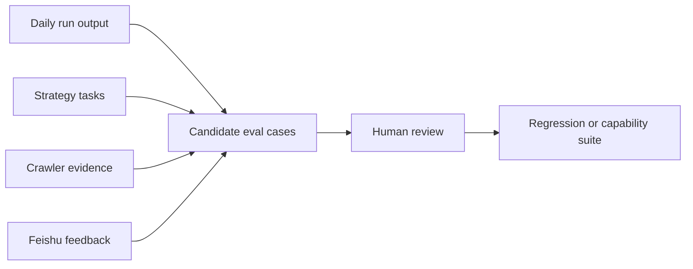

# Eval Case Feedback Loop

SmartJobHunter evals should grow from real daily runs, not only from hand-written
examples. This document defines how runtime failures and user feedback become
candidate eval cases, then stable regression coverage.

## Feedback Sources



Primary sources:

- `logs/strategy_tasks/`: strategy changes, blocked companies, fingerprint drift.
- `logs/crawler_evidence/`: page snapshots, API candidates, field samples.
- `output/{YYYY-MM-DD}/`: reports, application packages, unexpected empty runs.
- Feishu feedback: invalid link, not a fit, already applied, recommendation wrong.
- Human review: explicit labels for whether a role should be recommended.

## Candidate Case Format

Candidate cases should be written to:

```text
evals/candidates/{YYYY-MM-DD}/candidate_cases.yaml
```

Example:

```yaml
- id: candidate_20260511_001
  source: logs/strategy_tasks/example/task.json
  raw_evidence_path: logs/crawler_evidence/example/
  suggested_type: matching_intent
  suggested_suite: capability
  severity: high
  human_label: null
  reason: "Title contains AI, but the job is actually an engineering role."
```

## Promotion Rules

| Destination | Use When | Expected Pass Rate |
|:--|:--|:--|
| `evals/regression/jobhunter_core.yaml` | A real bug is fixed and must never regress | Should stay near 100% |
| `evals/capability/jobhunter_hard_cases.yaml` | The case probes a hard boundary or known weakness | Diagnostic, not a release blocker |
| `evals/candidates/...` | Evidence exists but the desired label is not confirmed | Not executed as a gate |

## Review Checklist

Before promoting a candidate:

- The input contains enough evidence to judge the expected behavior.
- The expected result is unambiguous to a domain reviewer.
- The case includes a clear `attribution`.
- The case uses a stable grader, preferably code-based.
- Any model/human grader is marked as skipped unless a calibrated judge exists.

## Attribution Map

| Attribution | Failure Means |
|:--|:--|
| `crawler_strategy` | The system chose the wrong crawl/evidence/block action. |
| `matching_filtering` | The system kept a bad job or dropped a good job. |
| `recommendation_quality` | Score, recommendation, risk, or evidence is wrong. |
| `output_quality` | Report, URL validation, package, or memory output is wrong. |
| `instruction_drift` | Agent-facing documents no longer describe the same workflow. |

## Minimum Maintenance Rhythm

- After every user-visible bug fix: add or promote one regression case.
- Weekly during active use: review candidate cases and delete duplicates.
- Monthly: review capability failures and decide which ones deserve product work.
- Before major prompt/tool/model changes: run regression with `--trials 3`.
