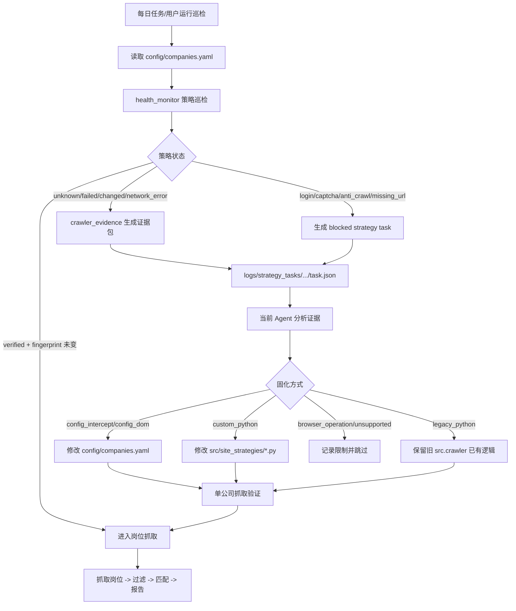

# 每日官网巡检与 Agent 策略固化实现计划

## 目标

落实 SmartJobHunter 的原始设计：用户维护公司官网/招聘链接，系统每日主动巡检这些链接和已固化抓取策略。发现新链接、链接失效、页面结构变化、API 变化、登录/验证码/反爬或无法解析时，Python 生成证据包和 strategy task；当前 Claude/Codex Agent 读取证据、判断抓取方式，并把可复用策略固化到 `config/companies.yaml` 或 `src/site_strategies/*.py`。

Python 不调用外部大模型 API。AI 分析指当前运行的 Claude/Codex Agent 平台分析证据并修改代码/配置。

## 当前职责边界

- 用户维护：`config/companies.yaml` 中的公司链接、启用状态、profile、简历文件。
- Python 执行：读取配置、打开官网、采集页面/网络证据、运行已固化爬虫、过滤/去重/粗评分、生成报告和任务文件。
- 当前 Agent 执行：分析 evidence、判断站点类型、修改 YAML 或 Python strategy、验证结果、评估岗位是否真的符合 profile。

## 运行总流程

## 已实现事项

- [x] 删除过期 `EXPAND_PLAN.md`、`RUN.md`。
- [x] 新增 `src/company_registry.py`，统一读取 `links` 和旧版 `urls`。
- [x] 新增 `src/site_inspector.py`，做轻量页面巡检、信号识别和 fingerprint。
- [x] 新增 `src/strategy_planner.py`，把巡检结果转成 `crawl`、`collect_evidence`、`blocked`。
- [x] 升级 `src/crawler_evidence.py`，输出 `evidence.json`、`network.json`、`page.html`、`page.txt`、`page.png`、`xhr_samples/`。
- [x] 重构 `src/health_monitor.py`，支持 `--inspect-strategies` 和 `--inspect-company`。
- [x] 保留 `src/crawler.py`，作为 `legacy_python` 策略来源接入新流程。
- [x] 新增 `src/site_strategies/base.py`，作为后续 custom strategy 接口。
- [x] 重构 `src/crawler_factory.py`，按 `strategy.type` 路由，并在失败时生成 strategy task。
- [x] 修复 `src/scheduler.py`，每日顺序改为先策略巡检，再跳过问题公司并继续抓可用公司。
- [x] 修复 `run_scheduled.bat`，入口改为 `python -m src.scheduler --schedule`。
- [x] `profiles/*.md` 每个文件作为独立巡检任务，报告使用 `_profile_id` 避免同名覆盖。
- [x] 同步 `AGENTS.md` 和 `CLAUDE.md` 的每日巡检规则。
- [x] 更新 `.claude/skills/jobhunter`，把抓取入口改为 `src.crawler_factory`，新增 `analyze_crawler_strategy` prompt。
- [x] 降级 `src/auto_analyzer.py` 为 legacy 模板匹配器，不再声称可独立完成 AI/API 分析。

## 岗位过滤和打分逻辑

现阶段 Python 里的 `src.matching` 是可测试 fallback，不等于最终 AI 判断：

1. `filters.filter_by_time`：按时间过滤。
2. `filters.dedup`：按 `memory/seen_jobs.md` 去重。
3. `filters.clean_data`：清洗、截断 JD。
4. `matching.match_job_intent`：根据 `target_roles`、`target_domains`、`must_have`、`avoid` 做保守语义过滤。
5. `matching.evaluate_job_fit`：结合 JD、profile、简历文本做粗评分、建议和风险提示。
6. 当前 Agent 必须复核报告岗位：岗位职责、简历证据、profile 目标三者是否闭环。

## 验收标准

- [ ] 非集成测试通过：`pytest -q -p no:cacheprovider -m "not integration"`。
- [ ] health/scheduler help 可运行：`python -m src.health_monitor --help`、`python -m src.scheduler --help`。
- [ ] 至少 3 家真实官网验证：腾讯、字节社招、美团。
- [ ] Agent 人工评估 3 家样本岗位是否符合 AI 产品经理/AI 应用产品/AI 解决方案方向。
- [ ] `AGENTS.md` 和 `CLAUDE.md` hash 完全一致。
- [ ] README/README_CN 暂不更新，等用户确认流程与预期一致后再同步。
